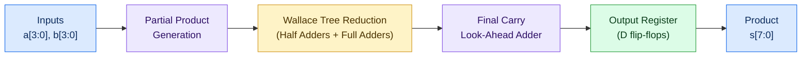

# 4-bit Wallace Tree Multiplier — Full-Custom, Transistor-Level IP Core


A 4-bit unsigned Wallace Tree multiplier designed, verified and characterized entirely at the **CMOS transistor level** in Cadence Virtuoso. The design uses no RTL, no HDL and no logic synthesis: every gate, carry path and timing parameter was captured as a hand-built schematic and signed off through transient simulation.

> [!NOTE]
> This is **Phase 1** of a custom ASIC project. > Phase 2 takes the same arithmetic architecture through a standard-cell RTL-to-GDSII flow: [4×4 Pipelined MAC Unit](https://github.com/GithubJayanta/MAC_unit_4bit).

---

## Contents

1. [Highlights](#highlights)
2. [Architecture](#architecture)
3. [Design Methodology](#design-methodology)
4. [Verification Strategy](#verification-strategy)
5. [PPA Results](#ppa-results)
6. [Waveforms and Schematics](#waveforms-and-schematics)
7. [Debug Case Study: Switching Glitches vs. Functional Failures](#debug-case-study-switching-glitches-vs-functional-failures)
8. [Key Takeaways](#key-takeaways)
9. [Tools](#tools)
10. [Repository Structure](#repository-structure)
11. [Related Work](#related-work)

---

## Highlights

| | |
|---|---|
| 🔵 **Design style** | Full-custom, transistor-level; no RTL and no synthesis |
| 🔵 **Technology** | 90 nm CMOS |
| 🟣 **Complexity** | 63 logic gates, 828 transistors (~207 gate-equivalents) |
| 🟢 **Maximum frequency** | ≈ 2.02 GHz (minimum clock period 495.691 ps) |
| 🟠 **Average dynamic power** | 2.22 µW |
| 🟠 **Power-delay product** | 0.877 fJ |
| 🟡 **Estimated area** | 134–201 µm² |
| 🔴 **Functional correctness** | 90–95% across the tested input combinations (transient simulation) |

---|---|
| **Design style** | Full-custom, transistor-level; no RTL and no synthesis |
| **Technology** | 90 nm CMOS |
| **Complexity** | 63 logic gates, 828 transistors (~207 gate-equivalents) |
| **Maximum frequency** | ≈ 2.02 GHz (minimum clock period 495.691 ps) |
| **Average dynamic power** | 2.22 µW |
| **Power-delay product** | 0.877 fJ |
| **Estimated area** | 134–201 µm² |

---

## Architecture

The multiplier follows the classic three-stage Wallace Tree organisation, with a registered output stage. All blocks are built from transistor-level primitives.



| Block | Description |
|---|---|
| **Partial Product Generation** | Produces the bitwise partial products of the two 4-bit operands |
| **Wallace Tree Reduction** | Compresses the partial-product matrix using half adders and full adders, minimising carry-propagation depth |
| **Carry Look-Ahead Adder** | Resolves the final two rows with parallel carry generation for a short critical path |
| **Output Register** | D flip-flop stage used for clocked timing characterization (clock-to-Q and setup) |

---

## Design Methodology

- **Bottom-up, hand-built schematics.** Each cell (gates, half adder, full adder, CLA, register) was designed at transistor level and composed hierarchically into the full multiplier.
- **No abstraction layer.** Without synthesis or technology mapping, carry propagation, gate count and silicon cost are direct results of design decisions.
- **Simulation-driven sign-off.** Function, delay, power and timing were all measured from transient simulation in Cadence Virtuoso.

---

## Verification Strategy

Functional verification was performed by transient simulation across comprehensive input combinations of `a[3:0]` and `b[3:0]`, observing the outputs `s[7:0]`.

> [!IMPORTANT]
> **Result: 90–95% functional correctness** across the tested input combinations. Switching glitches were separated from genuine functional failures during analysis, and only genuine failures count against this figure.

1. **Directed input sweep.** All operand inputs and product outputs were simulated together across a broad set of test vectors.
2. **Expected-vs-actual comparison.** Each simulated product was compared against the expected arithmetic result, on both the continuous analog waveforms and the discretized digital output bits.
3. **Registered-output check.** The output register's clock, data and captured output were examined to confirm correct timing behaviour.
4. **Glitch analysis.** Transient deviations were classified as either true functional errors or switching artifacts (see the [case study](#debug-case-study-switching-glitches-vs-functional-failures)).

---

## PPA Results

| Metric | Value |
|---|---|
| Functional correctness | 90–95% (transient simulation, tested input combinations) |
| Technology | 90 nm CMOS |
| Hardware complexity | 63 logic gates, 828 transistors (~207 gate-equivalents) |
| Estimated silicon area | 134–201 µm² |
| Average dynamic power | 2.22 µW |
| Critical combinational delay | 395 ps |
| Clock-to-Q delay | 72.691 ps |
| Setup time | 28 ps |
| **Minimum clock period** | **495.691 ps** |
| **Maximum operating frequency** | **≈ 2.02 GHz** |
| Power-delay product (PDP) | 0.877 fJ |

**Timing budget:** the minimum clock period is the sum of clock-to-Q delay, critical combinational delay and setup time:

```
T_min = t_clk-to-Q + t_comb,max + t_setup
      = 72.691 ps  + 395 ps     + 28 ps
      = 495.691 ps   →   f_max ≈ 2.02 GHz
```

---

## Waveforms and Schematics

| # | File | Description |
|---|---|---|
| 1 | `images/01_transistor_level_schematic.jpeg` | Full transistor-level schematic of the multiplier |
| 2 | `images/02_functional_verification_all_io.jpeg` | Transient simulation of all inputs (a0–a3, b0–b3) and outputs (s0–s7) across the test vectors |
| 3 | `images/03_dff_register_transient.jpeg` | Clock, data and registered-output response of an output register |
| 4 | `images/04_clock_to_q_delay_measurement.jpeg` | Measured clock-to-Q delay (72.691 ps) |
| 5 | `images/05_critical_path_delay_measurement.jpeg` | Measured critical combinational delay (~395 ps) |
| 6 | `images/06_dynamic_power_transient.jpeg` | Dynamic power transient showing switching-activity current spikes |
| 7 | `images/07_expected_vs_actual_output_validation_analog.jpeg` | Expected-vs-actual validation on the analog output waveforms, used to separate glitches from real failures |
| 8 | `images/08_expected_vs_actual_output_validation_discrete.jpeg` | Expected-vs-actual validation on the discretized digital output bits |

---

## Debug Case Study: Switching Glitches vs. Functional Failures

> [!TIP]
> A combinational block may glitch before it settles. Separating transient artifacts from real failures was the key debug step in this project.

During verification, the error signal between expected and simulated products did not settle to zero at every sample point, and it was not immediately clear whether the multiplier was faulty or the waveform was being misread.

**Approach**

1. Compared expected and actual outputs on the **analog** waveforms (figure 7) to see exactly where deviations occurred.
2. Repeated the comparison on the **discretized** output bits (figure 8), sampled after the outputs had settled.
3. Correlated each deviation with input transitions.

**Finding:** some deviations coincided with input transitions and disappeared once the outputs settled. These were **switching glitches** caused by unequal path delays through the reduction tree, not logic errors, and sampling after settling gave the correct product. Deviations that persisted after settling were treated as genuine functional failures, which is why the correctness figure is reported as 90–95% rather than as a glitch-inflated error count.

**Why it matters:** a combinational arithmetic block is allowed to glitch before it settles. Telling a transient artifact from a real functional failure is a core debug skill, and it is also why the registered output stage matters in a clocked design.

---

## Key Takeaways

- Working below RTL makes the costs hidden by synthesis visible: carry propagation depth, gate count and area all follow directly from design choices.
- The timing budget (clock-to-Q + combinational delay + setup) is easy to reason about when every delay is measured at the transistor level.
- Reliable verification needs more than a waveform check. It needs expected-vs-actual comparison and an understanding of glitch behaviour.

---

## Tools

- **Cadence Virtuoso:** schematic capture and transient transistor-level simulation

**Timeline:** June 2026

---

## Repository Structure

```
.
├── README.md
└── images/
    ├── 01_transistor_level_schematic.jpeg
    ├── 02_functional_verification_all_io.jpeg
    ├── 03_dff_register_transient.jpeg
    ├── 04_clock_to_q_delay_measurement.jpeg
    ├── 05_critical_path_delay_measurement.jpeg
    ├── 06_dynamic_power_transient.jpeg
    ├── 07_expected_vs_actual_output_validation_analog.jpeg
    └── 08_expected_vs_actual_output_validation_discrete.jpeg
```

---

## Related Work

- **Phase 2:** [4×4 Pipelined MAC Unit](https://github.com/GithubJayanta/MAC_unit_4bit), RTL-to-GDSII on SkyWater SKY130 using the standard-cell flow
- [4-bit Kogge-Stone Adder](https://github.com/GithubJayanta/4-Bit_Kogge_Stone_Adder), a related micro-architecture and PPA study

---

**Author:** Jayanta Chakraborty · [GitHub](https://github.com/GithubJayanta) · [LinkedIn](https://www.linkedin.com/in/jayanta-chakraborty-6625aa28a/)
